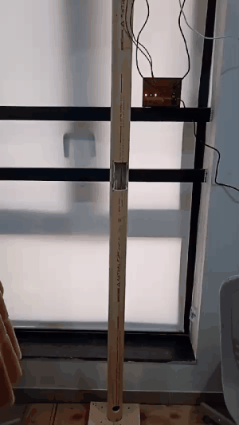
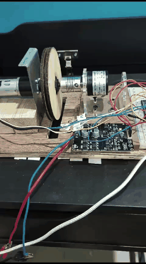
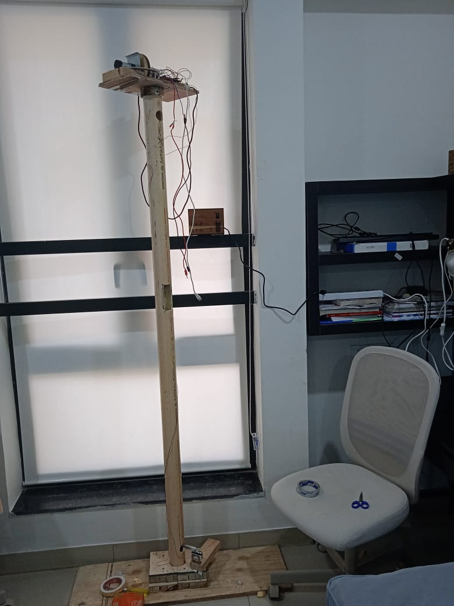
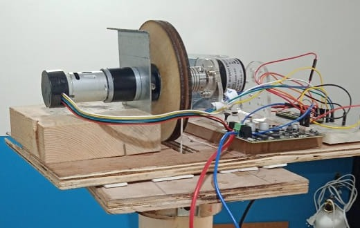

# Motor Test Rig

A rig for characterising low-cost DC gear motors. Built during a research internship advised by Prof. Andy Ruina (Jun–Aug 2024).

| Lift test | Sinusoid test |
|---|---|
|  |  |

Click a preview for the full video.

## Method

A pulley on the motor shaft lifts and lowers different weights at different PWM levels. Comparing runs across weights and PWM levels gives the motor's dynamic torque at different speeds and loads.

| Full rig | Motor and pulley |
|---|---|
|  |  |

## In progress

Measuring three deadbands separately:

1. Gear backlash
2. Voltages too small to turn the motor
3. Static friction

Results will be added when the measurements are done.
